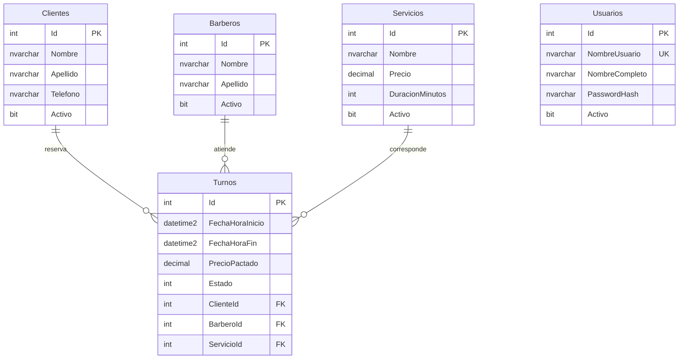

# Modelo entidad–relación

Basado en TurnifyDbContext y la migración Inicial. Todas las columnas son obligatorias. Los identificadores son int IDENTITY(1,1).

## Diccionario físico

| Tabla | Columnas y tipos SQL Server |
| --- | --- |
| Clientes | Id int PK; Nombre nvarchar(100); Apellido nvarchar(100); Telefono nvarchar(30); Activo bit |
| Barberos | Id int PK; Nombre nvarchar(100); Apellido nvarchar(100); Activo bit |
| Servicios | Id int PK; Nombre nvarchar(100); Precio decimal(18,2); DuracionMinutos int; Activo bit |
| Turnos | Id int PK; FechaHoraInicio datetime2; FechaHoraFin datetime2; PrecioPactado decimal(18,2); Estado int; ClienteId int FK; BarberoId int FK; ServicioId int FK |
| Usuarios | Id int PK; NombreUsuario nvarchar(50) UNIQUE; NombreCompleto nvarchar(150); PasswordHash nvarchar(max); Activo bit |

Cada turno tiene exactamente un cliente, un barbero y un servicio; cada uno puede relacionarse con cero o muchos turnos. Las FK no eliminan turnos en cascada. Usuarios no tiene relación con Turnos: no se registra el usuario creador en esta versión.

- NombreUsuario tiene un índice único: IX_Usuarios_NombreUsuario.
- Turnos tiene índices sobre ClienteId, BarberoId y ServicioId.
- Estado: 1 Pendiente, 2 Completado, 3 Cancelado.
- PrecioPactado y la diferencia entre fin e inicio conservan precio y duración históricos.
- Las validaciones de precio, duración y estado se aplican en la lógica; no se definieron restricciones CHECK en la migración.
- La clase C# de Servicios se llama Service; la tabla se llama Servicios.
- __EFMigrationsHistory es una tabla técnica y no forma parte del dominio.

GitHub permite visualizar el bloque Mermaid de este documento.
